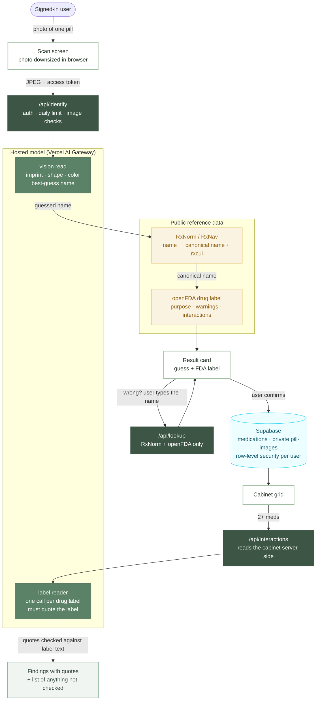

# PillID — How it works

A hosted vision model (through Vercel AI Gateway) reads the photo and suggests a name.
Every drug fact shown comes from public data (openFDA labels + RxNorm), and the user
confirms the name against the packaging before anything is saved.

## The grounding contract

| Stage | Who decides | Source of truth |
|-------|-------------|-----------------|
| Read the pill | hosted vision model | the photo only — a suggestion, not an identification |
| Final name | **the user**, against the packaging | the packaging |
| Canonical name + `rxcui` | RxNorm / RxNav | NIH RxNorm |
| Purpose / warnings / interaction text | openFDA | FDA drug labels |
| Which cabinet drugs a label warns about | model, one label at a time | that label's text; each finding carries a quote that is checked against the label |
| Severity | model estimate | none — FDA labels do not grade interactions, and the UI says so |

> The NIH RxNav **Drug Interaction API** was retired in Jan 2024, so interaction warnings are
> grounded in each drug's openFDA label text rather than a dedicated interaction endpoint.
