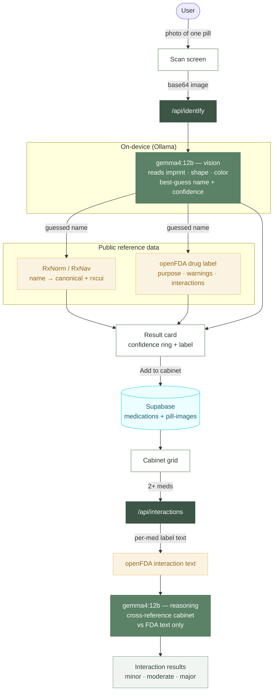

# PillID — How it works

End-to-end flow. The vision model runs **locally** (gemma4:12b via Ollama); all drug
facts are **grounded** in public data (openFDA labels + RxNorm). The model never invents
warnings or interactions.

## The grounding contract

| Stage | Who decides | Source of truth |
|-------|-------------|-----------------|
| Read the pill | `gemma4:12b` (local vision) | the photo only |
| Canonical name + `rxcui` | RxNorm / RxNav | NIH RxNorm |
| Purpose / warnings / interaction text | openFDA | FDA drug labels |
| Interaction pairs + severity | `gemma4:12b` *matches & scores* | **only** the openFDA label text provided |

> The NIH RxNav **Drug Interaction API** was retired in Jan 2024, so interaction warnings are
> grounded in each drug's openFDA label text rather than a dedicated interaction endpoint.
